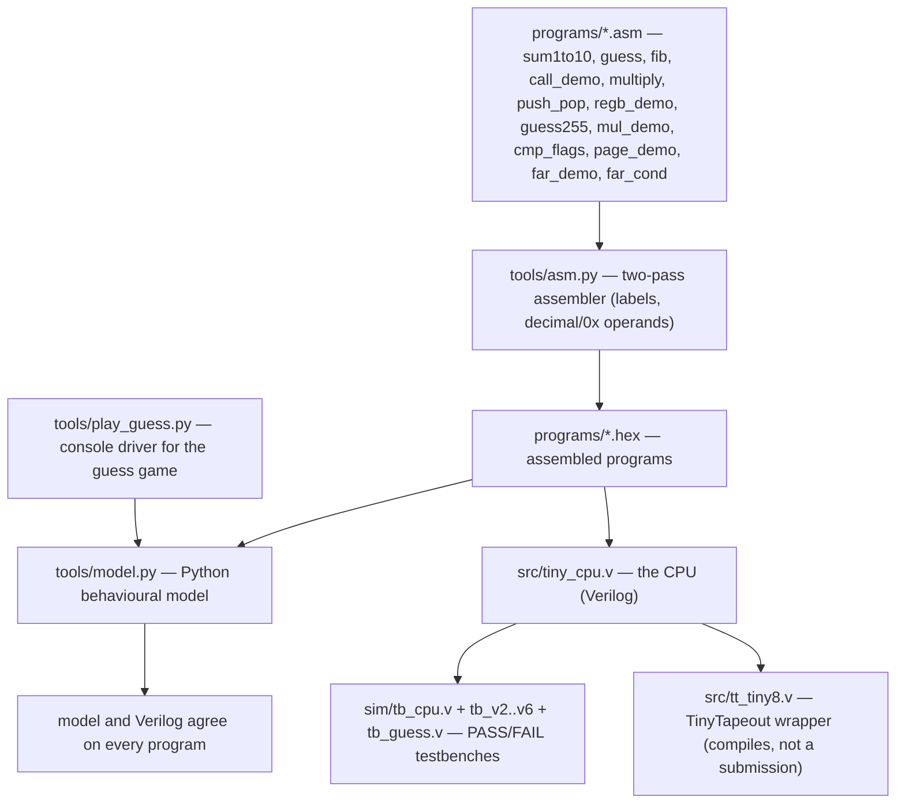

# tiny8 v6 — a minimal 8-bit CPU, built from zero

A tiny accumulator CPU in Verilog: 8-bit data path, 16-bit instruction words,
Harvard memory (256-word ROM + 256-byte RAM), one flag (Z), two memory-mapped
ports (read `0xFE` = input pins, write `0xFF` = output pins). Multi-cycle design:
every instruction takes FETCH + EXECUTE (2 clocks).

**v2 power upgrade:** the formerly reserved `[11:8]` field now carries
extended instructions — JNZ, CALL, and RET — with a stack growing down from
the top of RAM (SP resets to `0xFE`). All v1 programs assemble identically
and run unchanged on v2, because v1 NOPs have extension 0.

**v3 power upgrade:** a second register B, plus stack data ops, in the same
extension field — TAB, TBA, ADDB, SUBB, PUSH, POP. LDI still loads A only,
so B survives across it; that is what makes B useful as a counter or a
saved value. v1 and v2 programs run unchanged on v3.

**v4 power upgrade:** a carry/borrow flag C, real comparisons, and hardware
multiply, again in the extension field — CMP, JC, JNC, MUL. C is set by
ADD/ADDI/ADDB carry and SUB/SUBB/CMP borrow, and left alone by everything
else, so JC/JNC can branch on unsigned comparisons. v1–v3 programs run
unchanged on v4.

**v5 power upgrade:** 64KB of RAM, addressed 16-bit style. B is the page
register: LDAX/STAX use the effective address (B << 8) | operand, while
all the old zero-page instructions still use addresses 0..255 exactly as
before. That puts tiny8 in 6502 territory for addressing — an 8-bit core
that can see a full 64KB. v1–v4 programs run unchanged on v5. (In
simulation the RAM is a 64KB array; a real chip would implement it as
SRAM, not flip-flops.)

**v6 power upgrade:** the last ceiling falls — a 16-bit program counter
and a 64K-word ROM, so programs are no longer capped at 256 words.
JMPF/JZF jump to (B << 8) | operand, using the [11:8] field of JMP/JZ,
which was always 0 in v1–v5. CALL/RET now push/pop a 16-bit return
address (high byte first, then low byte), and a far call needs no new
opcode: push the return address by hand, set B to the page, JMPF, and
let RET pop it back. The assembler gained ORG, so code can be placed
at a far address. v1–v5 programs run unchanged on v6, with identical
step counts.

> 🐼 New here? Start with the [beginner explainer](EXPLAINED_FOR_BEGINNERS.md) — plain language, one analogy, verified vs not-proved labels.

## ISA

| Opcode | Mnemonic | Behaviour |
|--------|----------|-----------|
| 0x0 | NOP | do nothing |
| 0x1 | LDI imm | A ← imm |
| 0x2 | LDA addr | A ← MEM[addr] |
| 0x3 | STA addr | MEM[addr] ← A |
| 0x4 | ADD addr | A ← A + MEM[addr] |
| 0x5 | ADDI imm | A ← A + imm |
| 0x6 | SUB addr | A ← A − MEM[addr] |
| 0x7 | AND addr | A ← A & MEM[addr] |
| 0x8 | OR addr | A ← A \| MEM[addr] |
| 0x9 | XOR addr | A ← A ^ MEM[addr] |
| 0xA | NOT | A ← ~A |
| 0xB | SHL | A ← A << 1 |
| 0xC | SHR | A ← A >> 1 |
| 0xD | JMP addr | PC ← addr |
| 0xE | JZ addr | if (Z) PC ← addr |
| 0xF | HLT | halt forever |

v2 extended instructions (opcode `0x0`, extension in `[11:8]`):

| Ext | Mnemonic | Behaviour |
|-----|----------|-----------|
| 1 | JNZ addr | if (!Z) PC ← addr |
| 2 | CALL addr | push PC; PC ← addr |
| 3 | RET | PC ← pop() |
| 4 | TAB | B ← A (flags untouched) |
| 5 | TBA | A ← B (flags untouched) |
| 6 | ADDB | A ← A + B (sets Z) |
| 7 | SUBB | A ← A − B (sets Z) |
| 8 | PUSH | push A (flags untouched) |
| 9 | POP | A ← pop() (sets Z, like a load) |
| A | CMP addr | compare A with MEM[addr]: A unchanged, Z = equal, C = A < MEM |
| B | JC addr | if (C) PC ← addr |
| C | JNC addr | if (!C) PC ← addr |
| D | MUL | A ← A × B, low byte (sets Z, C untouched) |
| E | LDAX addr | A ← RAM[(B << 8) \| addr] (sets Z, RAM only) |
| F | STAX addr | RAM[(B << 8) \| addr] ← A (flags untouched) |

v6 far jumps (JMP/JZ with [11:8] = 1, B = program page):

| Mnemonic | Behaviour |
|----------|-----------|
| JMPF addr | PC ← (B << 8) \| addr |
| JZF addr | if (Z) PC ← (B << 8) \| addr |

Assembler extras: `ORG <address>` places following code at that address
(padding with HLT); labels work across ORG as usual.

Instruction word: `[15:12]` opcode, `[11:8]` extension (v2), `[7:0]` operand.
Z is set by ALU/load results only — STA, JMP, JZ, JNZ, CALL, RET, HLT, NOP
leave it alone, which is what makes `ADD` + `JZ`/`JNZ` loops work. The stack
lives at the top of RAM and grows down; keep program data below `0xF0` so
deep calls never collide with it, and never RET without a CALL.

## Files

- `src/tiny_cpu.v` — the CPU
- `tools/asm.py` — two-pass assembler (labels, decimal/`0x` operands)
- `tools/model.py` — Python behavioural model, cross-checks the Verilog
- `programs/sum1to10.asm` — first program: sums 1..10, outputs 55
- `programs/guess.asm` — guess-the-number: one CPU run per guess, out_port 1 = too low, 2 = too high, 255 = win
- `programs/fib.asm` — v2 JNZ demo: Fibonacci(10) = 55, no testbench preload needed
- `programs/call_demo.asm` — v2 nested CALL/RET demo: 7 + 5 + 100 = 112, stack depth 2
- `programs/multiply.asm` — v3 demo: 6 × 7 = 42, B as the loop counter
- `programs/push_pop.asm` — v3 demo: subroutine saves/restores A via PUSH/POP, out 42, RAM 0x11 = 7
- `programs/regb_demo.asm` — v3 demo: TAB/ADDB/SUBB, out 10, B = 20 survives LDI
- `programs/guess255.asm` — v4 game: guess-the-number over the full 0..255 range, via CMP + JC (the old game only worked for 1..100)
- `programs/mul_demo.asm` — v4 demo: 15 × 15 = 225 in one MUL instruction
- `programs/cmp_flags.asm` — v4 demo: JC and JNC both taken, out 77
- `programs/page_demo.asm` — v5 demo: zero-page RAM[16] = 42, page-1 RAM[288] = 99, page-2 RAM[767] = 7, out 99
- `programs/far_demo.asm` — v6 demo: far call to address 256 via manual push + JMPF + RET, out 7, RAM 0x11 = 7
- `programs/far_cond.asm` — v6 demo: conditional far jump (JZF) to address 256, out 88
- `src/tt_tiny8.v` — TinyTapeout wrapper (ui_in → in_port, uo_out → out_port, halted on uio_out[0]); compiles, not a submission
- `tools/play_guess.py` — console driver for the game (the CPU decides every hint)
- `sim/tb_cpu.v` — testbench, prints PASS/FAIL
- `sim/tb_guess.v` — guess-game testbench, prints PASS/FAIL per guess
- `sim/tb_v2.v` — v2 testbench (fib + call_demo), prints PASS/FAIL
- `sim/tb_v3.v` — v3 testbench (multiply + push_pop + regb_demo), prints PASS/FAIL
- `sim/tb_v4.v` — v4 testbench (mul_demo + cmp_flags + guess255 cases), prints PASS/FAIL
- `sim/tb_v5.v` — v5 testbench (page_demo, all three RAM locations checked), prints PASS/FAIL
- `sim/tb_v6.v` — v6 testbench (far_demo + far_cond), prints PASS/FAIL

## Run it

```sh
./run.sh        # assembles, runs the Python model, compiles + simulates the Verilog
```

Verified 25 Oct 2026: Python model and Icarus Verilog simulation agree —
sum 1..10 = 55, halted, 86 instructions / 173 cycles.

## Play a game on tiny8

```sh
python3 tools/play_guess.py                  # interactive, random secret 1..100
python3 tools/play_guess.py --secret 42 --guesses 20,60,42   # scripted demo
```

The game logic is all in the CPU (`programs/guess.asm`, 26 words, no new
instructions): secret − guess via SUB, win on Z, and too-high vs too-low
from whether the mod-256 difference is ≥ 128 (tested by seven SHRs, then
JZ). The driver is only the console — it feeds one guess per CPU run
through `in_port` and prints the `out_port` hint. Guesses must be 1..100,
because that range is what makes the ≥ 128 test valid.

Verified 25 Oct 2026: Python model and Icarus Verilog agree on every guess
case — 20 → 1, 60 → 2, 42 → 255, 1 → 1, 100 → 2 — and the scripted game
20, 60, 42 wins in 3 attempts.

v2 verified the same night, model and Verilog agreeing: fib = 55
(110 model steps / 221 Verilog cycles), nested call demo = 112
(17 steps / 35 cycles), SP back to `0xFE` in both — and sum + guess
still pass unchanged on v2.

v3 verified the same night, model and Verilog agreeing: multiply = 42
(58 steps / 117 cycles), push_pop = 42 with RAM 0x11 = 7
(9 steps / 19 cycles), regb_demo = 10 with B = 20
(7 steps / 15 cycles), SP back to `0xFE` in all three — and every
v1/v2 program still passes with identical step counts on v3.

v4 verified the same night, model and Verilog agreeing: mul_demo = 225
(6 steps / 13 cycles), cmp_flags = 77 (11 steps / 23 cycles),
guess255 = 20 → 1, 60 → 2, 42 → 255, 0 → 1, 255 → 2 (C = 1 on the
low cases, 0 on the high/win cases, in both models) — and every
v1–v3 program still passes with identical step counts on v4.

Full-range game: `python3 tools/play_guess.py --full-range` (secret and
guesses 0..255; without the flag, the original 1..100 game is unchanged).

v5 verified the same night, model and Verilog agreeing: page_demo = 99
(15 steps / 31 cycles), with RAM[16] = 42, RAM[288] = 99, and RAM[767] = 7
all confirmed in both models — and every v1–v4 program still passes with
identical step counts on v5.

v6 verified the same night, model and Verilog agreeing: far_demo = 7
(13 steps / 27 cycles, RAM 0x11 = 7, SP back to `0xFE`), far_cond = 88
(7 steps / 15 cycles) — and every v1–v5 program still passes with
identical step counts on v6, including call_demo with the new 2-byte
CALL/RET. One real bug was caught and fixed at the program level, not
the CPU: the first far_cond set Z, then cleared it with LDI 1 before
the jump; reordering (set B first, then LDI 0) fixed it in both models.

## Roadmap

1. Synthesis with Yosys → gate count + area estimate on SkyWater 130nm.
   Yosys is NOT installed in this VM, so no gate count is claimed yet;
   the TinyTapeout wrapper compiles and elaborates with Icarus Verilog.
2. TinyTapeout tile: submit the wrapper from Jayant's own TinyTapeout
   account to a shuttle (needs his account + a confirmed shuttle slot;
   the 64KB RAM/ROM arrays would need SRAM macros for a real chip).
3. Next power steps, if you want them: interrupts + a timer, or a second
   display/keypad port. The instruction encoding is now full (all 16
   extension slots used), so further instructions would need a prefix
   scheme or a wider instruction word — that is the honest next ceiling.

## 🗺️ Project map



## 📊 At a glance (facts checked against the repo 30 Oct 2026; program results as recorded in the README, 25 Oct 2026)

| Measure | Value |
|---|---|
| What | A minimal 8-bit accumulator CPU in Verilog, built from zero — v6 |
| Data path | 8-bit data, 16-bit instruction words: [15:12] opcode, [11:8] extension, [7:0] operand |
| Memory | Harvard: 256-word ROM (v1–v5) → 64K-word ROM in v6; 256-byte RAM → 64KB RAM in v5 (B is the page register) |
| Timing | Multi-cycle: every instruction takes FETCH + EXECUTE (2 clocks) |
| Flags | Z (set by ALU/load results only); C carry/borrow (v4, set by ADD/ADDI/ADDB carry and SUB/SUBB/CMP borrow) |
| Ports | Memory-mapped: read 0xFE = input pins, write 0xFF = output pins |
| Registers | A accumulator, B second register (v3), 16-bit PC (v6), SP resets to 0xFE, stack grows down from top of RAM |
| ISA | 16 base opcodes (NOP, LDI, LDA, STA, ADD, ADDI, SUB, AND, OR, XOR, NOT, SHL, SHR, JMP, JZ, HLT) + 15 extensions in the [11:8] field (JNZ, CALL, RET, TAB, TBA, ADDB, SUBB, PUSH, POP, CMP, JC, JNC, MUL, LDAX, STAX) + v6 far jumps JMPF/JZF |
| Backwards compatibility | Every version runs all earlier programs unchanged, with identical step counts (v1–v5 on v6) |
| Demos | sum 1..10 = 55 (86 instructions / 173 cycles); fib(10) = 55; 6 x 7 = 42; 15 x 15 = 225 in one MUL; guess game (1..100 and 0..255); far call to address 256 |
| Files | 41: src/tiny_cpu.v, src/tt_tiny8.v, sim/tb_cpu.v + tb_v2..v6 + tb_guess.v, tools/asm.py, tools/model.py, tools/play_guess.py, run.sh, 13 programs with .asm + .hex, EXPLAINED_FOR_BEGINNERS.md |
| Run it | ./run.sh — assembles, runs the Python model, compiles + simulates the Verilog |
| Honest limits | No gate count claimed yet (Yosys not installed in the VM); TinyTapeout wrapper compiles and elaborates with Icarus Verilog but is not a submission; the 64KB arrays would need SRAM macros for a real chip; all 16 extension slots are now used, so further instructions need a prefix scheme or a wider word |
